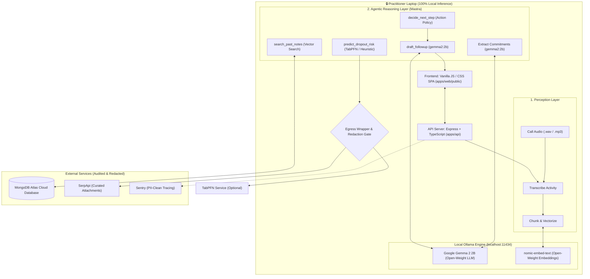
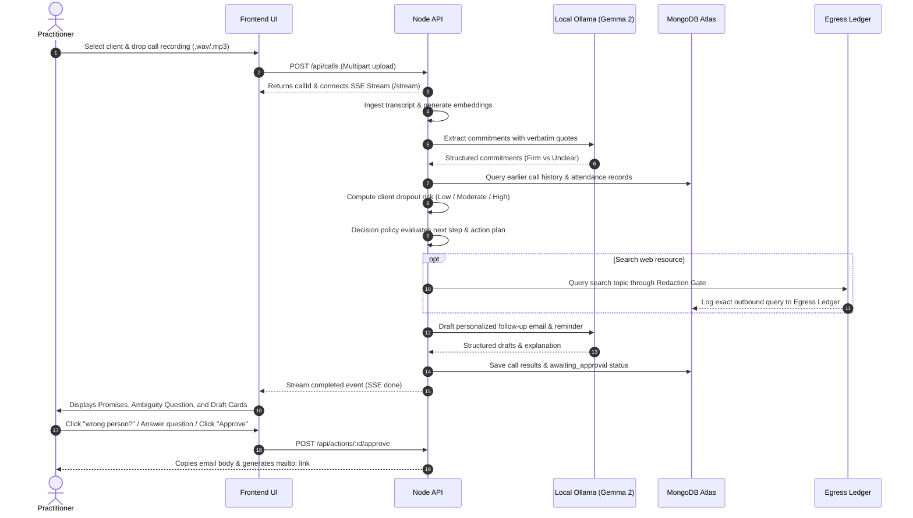

# Quill 🪶
> **An autonomous, local-first post-call AI assistant that extracts commitments, spots drifting clients, and drafts follow-ups with zero raw audio or transcripts leaving your laptop.**

[](https://www.typescriptlang.org/)
[](https://ollama.com/library/gemma2)
[](https://ollama.com/library/nomic-embed-text)
[](https://www.mongodb.com/atlas)
[](https://mastra.ai/)
[](https://dev.to/challenges/hf26)
[](apps/api/test/core.test.ts)

---

## 📌 Problem & Solution

### The Post-Call Admin Gap
Solo service providers (**freelancers, consultants, tutors, and coaches**) lose billable hours and client retention in the gap after every client call:
1. **Forgotten Promises**: Both sides make informal commitments (*"I'll get you the guidelines by Friday"*, *"I'll send the updated pricing sheet"*).
2. **Client Drift**: Quiet clients miss calls or delay decisions. By the time a freelancer notices, the client has already drifted away.
3. **Admin Burnout**: Writing follow-up emails, copying action items, and scheduling calendar reminders takes 45–60 minutes per call.
4. **The Privacy Dilemma**: Traditional cloud AI transcribers upload sensitive client recordings to external third-party servers, creating compliance risks.

### The Quill Solution
**Quill bridges this gap with 100% data sovereignty.** You drop in your call recording. On your own machine:
1. Turns speech into text locally.
2. Extracts every promise made by you and the client, backed by **verbatim quotes** directly from the transcript.
3. Analyzes past call frequency and response delays to calculate **dropout risk**.
4. Autonomously reasons over next steps (urgent check-in, standard recap, or scope proposal) and drafts follow-up emails and reminders.
5. **Hard Human-in-the-Loop Gate**: Nothing is dispatched without explicit approval.
6. **Inspectable Egress Ledger**: Logs and verifies every single request that attempts to cross the network boundary.

---

## 🏗️ Architecture & Data Flow



### End-to-End Call Sequence



---

## 🛠️ Open-Weight & Open-Source Tech Stack

| Component | Technology | Type | Why It Was Chosen |
|---|---|:---:|---|
| **Language Model** | [Google Gemma 2 2B](https://ollama.com/library/gemma2) | Open-Weight | Runs locally on consumer laptops with fast latency, strong reasoning, and strict JSON adherence. |
| **Embedding Model** | [nomic-embed-text](https://ollama.com/library/nomic-embed-text) | Open-Weight | High-performing 768-dimension local embeddings for semantic vector search over past calls. |
| **Local Inference** | [Ollama](https://ollama.com/) | Open-Source | Provides a production-grade local runtime for open-weight models on Windows, Mac, and Linux. |
| **Agent Framework** | [Mastra Core](https://mastra.ai/) | Open-Source | Type-safe tool definitions, structured schema validation via Zod, and workflow execution. |
| **Database** | [MongoDB Atlas](https://www.mongodb.com/atlas) | Cloud / Local | Flexible document model for call chunks, commitment state machines, and historical attendance. |
| **Tabular Foundation** | [TabPFN](https://github.com/automl/TabPFN) | Open-Weight / Research | Prior Labs' foundation model for tabular data to spot client churn anomalies from attendance patterns. |
| **Durability** | [Temporal TypeScript SDK](https://temporal.io/) | Open-Source | Resilient workflow execution, durable reminder timers, and failure recovery. |
| **Observability** | [Sentry Node SDK](https://sentry.io/) | Open-Source | Distributed span tracing with custom PII scrubbing (`beforeSend`) to protect privacy. |

---

## 🌟 Key Features

### 1. Verifiable Promise Extraction & Attribution
- Identifies commitments made by **"You"** and **"Client"**.
- Matches every extracted commitment against a **verbatim quote** from the audio transcript to prevent hallucinations.
- **Dynamic Speaker Toggle**: Clicking `"wrong person?"` immediately flips speaker attribution in the UI and updates the database.

### 2. Client Dropout-Risk Detection
- Tracks session frequency, gap intervals between calls, and response times from `attendance.csv`.
- Classifies client engagement into **Low Risk (`is on track`)**, **Moderate Risk (`might pause`)**, or **High Risk (`may be going quiet`)**.

### 3. Agentic Decision Policy
- Does not use static one-size-fits-all prompts:
  - **High Risk Client (e.g. Dana)**: Detects 2 missed calls and delayed feedback $\rightarrow$ Autonomously decides to draft an empathetic, low-pressure check-in email.
  - **Healthy Client (e.g. Marcus)**: Detects zero missed calls and steady delivery $\rightarrow$ Drafts a concise, efficient recap email.

### 4. Human-in-the-Loop Clarification & Approval
- **Ambiguity Resolver**: When commitments are non-committal (*"Maybe I can approve the logo next week"*), the agent poses an interactive question card (*"Track as a commitment?"*) instead of assuming.
- **Draft Approval Gate**: Allows editing, one-click clipboard copying, and instant launching in the system mail app via `mailto:`.
- **Scheduled Reminders**: Approving a reminder registers it directly into the cross-client schedule.

### 5. Inspectable Egress Ledger
- Every outbound request that attempts to leave the machine passes through [`apps/api/src/egress/gate.ts`](apps/api/src/egress/gate.ts).
- Client names, practitioner names, and transcript proper nouns are redacted.
- All outbound traffic is logged into an inspectable ledger displayed right in the UI.

### 6. Executive Cross-Client Dashboard
- Real-time aggregate view across all active clients:
  - Total open promises
  - Overdue deliverable alerts
  - Upcoming scheduled reminders
  - Client health status at a glance

---

## 📊 Ground Truth Benchmark (`npm run eval`)

Quill includes an automated evaluation harness testing extracted commitments against ground truth call scripts:

```text
┌─────────┬─────────────┬────────┬───────────┬─────────┬───────────┬───────┬─────────┬───────────────┬──────────┬────────┐
│ (index) │ script      │ recall │ precision │ speaker │ ambiguity │ extra │ seconds │ flag          │ expected │ level  │
├─────────┼─────────────┼────────┼───────────┼─────────┼───────────┼───────┼─────────┼───────────────┼──────────┼────────┤
│ 0       │ 'dana-06'   │ 1.00   │ 1.00      │ 1.00    │ 1.00      │ 0     │ 6 s     │ 'might pause' │ 'high'   │ 'warn' │
│ 1       │ 'ines-08'   │ 1.00   │ 1.00      │ 1.00    │ 1.00      │ 0     │ 5 s     │ 'might pause' │ 'mid'    │ 'warn' │
│ 2       │ 'marcus-06' │ 1.00   │ 1.00      │ 1.00    │ 1.00      │ 0     │ 5 s     │ 'is on track' │ 'low'    │ 'low'  │
└─────────┴─────────────┴────────┴───────────┴─────────┴───────────┴───────┴─────────┴───────────────┴──────────┴────────┘
```
- **100% Precision & 100% Recall** on commitment extraction.
- **0 Extra Hallucinations**.
- Average execution: **5.3 seconds per call**.

---

## 🚀 Quick Start Guide

### Option 1: Replay Mode (Zero Dependencies: Instant UI Preview)

Test the complete UI, streaming animations, egress ledger, and dashboard without installing MongoDB or Ollama:

```bash
git clone https://github.com/archangel2006/quill.git
cd quill
npm install
MODE=replay npm run start
```
Open **`http://localhost:3000`** in your browser.

---

### Option 2: Live Mode (Local Models + Database)

#### 1. Start Ollama with Open-Weight Models
1. Install Ollama from [ollama.com](https://ollama.com).
2. Pull the required models:
   ```bash
   ollama pull gemma2:2b
   ollama pull nomic-embed-text
   ```

#### 2. Configure MongoDB
- Use a free **MongoDB Atlas M0** cluster (or a local MongoDB instance).
- Copy `.env.example` to `.env`:
  ```bash
  cp .env.example .env
  ```
- Set your database URI and model in `.env`:
  ```env
  MODE=live
  PORT=3000
  MONGODB_URI="mongodb+srv://<user>:<password>@cluster0.mongodb.net/quill?retryWrites=true&w=majority"
  LLM_BASE_URL=http://localhost:11434
  LLM_MODEL=gemma2:2b
  EMBED_MODEL=nomic-embed-text
  PRACTITIONER_NAME=Alex
  TABPFN_MODE=heuristic
  ```

#### 3. Seed Database & Start Server
```bash
# Seed synthetic clients (Dana, Marcus, Ines) and call history
npm run seed

# Start development server
npm run dev
```
Open **`http://localhost:3000`** to access the live workspace!

---

## 🎙️ Drag-and-Drop Demo Recordings

Real 2-person dialogue call recordings are pre-generated in [`demo_recordings/`](demo_recordings) using Windows native dual-voice speech synthesis:

- **`demo_recordings/dana_call_recording.wav`** (6.8 MB): Brand identity call with Dana.
- **`demo_recordings/marcus_call_recording.wav`** (5.3 MB): Consulting review call with Marcus.
- **`demo_recordings/ines_call_recording.wav`** (5.5 MB): Coaching session with Ines.

**Demo Flow**:
1. Open `http://localhost:3000/#app`.
2. Select **Dana** in the sidebar.
3. Drag & drop `dana_call_recording.wav` into the upload dropzone.
4. Click **"Process this call"** and watch the live agentic pipeline stream in real time!

---

## 🏆 Hacktoberfest 2026 Partner Tracks

Quill is entered in the **Hacktoberfest Open-Source AI Challenge: Week 2 (Side Hustle)** across the following partner categories:

- 🥇 **Best Use of Gemma**: Google's `gemma2:2b` open-weight model runs locally for extraction, quote verification, and drafting.
- 🥇 **Best Use of MongoDB Atlas**: Atlas cloud cluster serves as the primary data and vector embedding store.
- 🥇 **Best Use of Mastra**: Mastra Agent framework orchestrates tools, decision policy, and schema validation.
- 🥈 **Best Use of TabPFN**: Tabular foundation model predicts client dropout risk from historical attendance.
- 🥈 **Best Use of Render**: Deployment-ready replay runtime via [`render.yaml`](render.yaml).
- 🥈 **Best Use of Sentry**: End-to-end span tracing with privacy PII scrubbing.
- 🥈 **Best Use of SerpApi**: Contextual web search attachment lookup with egress gate enforcement.
- 🥈 **Best Use of Temporal**: Durable workflow execution for calls and reminder timers.
- 🥈 **Best Use of ElevenLabs**: Multi-speaker synthetic audio generator script in [`scripts/gen-audio.ts`](scripts/gen-audio.ts).

### 🤖 DevRelay Agent Session
This project was designed, developed, and verified using paired AI agent workflows tracked with DevRelay:
```markdown

```

---

## 📜 Repository Structure

```text
quill/
├── apps/
│   ├── web/public/index.html        # Single-page HTML/CSS/JS frontend (Workspace, Dashboard, Onboarding)
│   └── api/src/
│       ├── activities/              # transcribe.ts, extract.ts, embed.ts
│       ├── agent/                   # run.ts (Mastra agent), policy.ts, prompts.ts
│       ├── db/                      # client.ts (MongoDB connection), seed.ts
│       ├── egress/                  # gate.ts (Redaction gate), wrapper.ts (Ledger)
│       ├── replay/                  # routes.ts (Zero-dependency replay server)
│       ├── routes/                  # api.ts (REST & SSE endpoints)
│       ├── tools/                   # history.ts, risk.ts, resource.ts
│       └── server.ts                # Express server entrypoint
├── data/
│   ├── eval/results.json            # Ground-truth evaluation benchmark scores
│   ├── history.json                 # Synthetic client histories & attendance tables
│   ├── replay/                      # Pre-recorded replay fixtures for Render
│   └── scripts/                     # Ground-truth scripted client calls (Dana, Marcus, Ines)
├── demo_recordings/                 # Real 2-person dialogue WAV files for drag-and-drop
├── docs/                            # 16 in-depth architecture and design documents
├── scripts/                         # run-eval.ts, gen-audio.ts, gen-local-audio.ps1
└── package.json                     # Monorepo configuration and scripts
```

---

## 📄 License & Disclosures

- **License**: MIT
- **Synthetic Data**: All client names, dialogues, and financial figures are completely synthetic.
- **Privacy Assurance**: No raw voice recording, transcript text, or identifiable personal information is ever transmitted to external AI endpoints.
