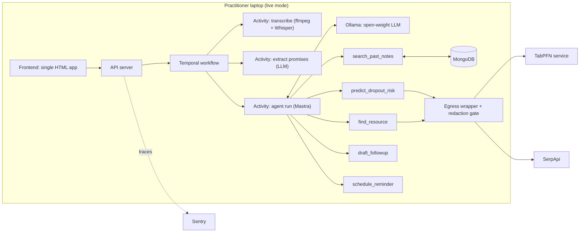
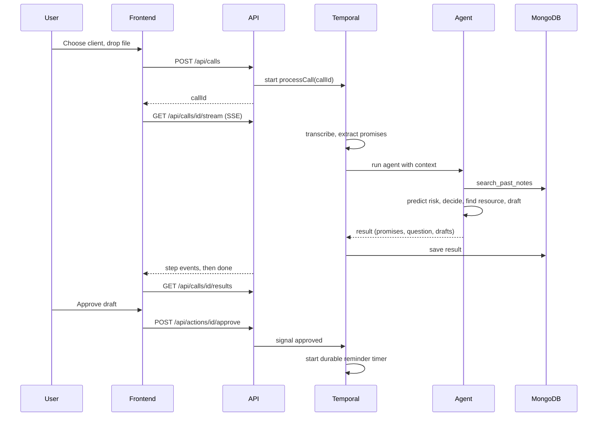
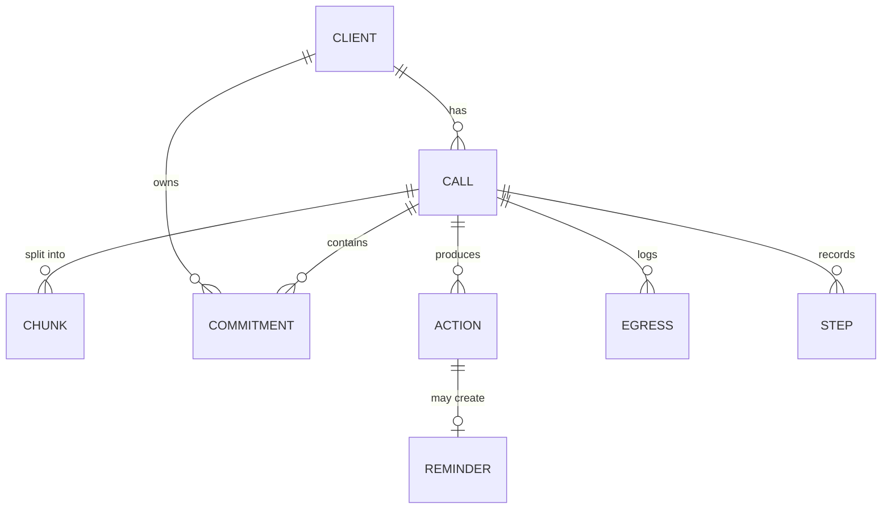

# 02. Architecture

## Two modes, one codebase

| Mode | Where | Model and data | Purpose |
|---|---|---|---|
| **live** | Your laptop | Real Whisper, Ollama, local MongoDB, Temporal dev server | The real product, the demo video, benchmarks |
| **replay** | Render | Pre-recorded agent runs served from JSON, Atlas free cluster with synthetic data | Public link people can click |

Render's free tier cannot run a model or Temporal, so the public site replays recorded runs. Say so plainly in the post.

## System overview



## One call, end to end



## Data model



Fields are in [07-data-and-database](07-data-and-database.md).

## Components

| Component | Tech | Doc |
|---|---|---|
| Frontend | Plain HTML, CSS, JS (already built) | 03 |
| API | Node and TypeScript, Express | 04 |
| Agent | Mastra, zod tool schemas | 05 |
| Speech | ffmpeg, whisper.cpp | 06 |
| LLM and embeddings | Ollama with an open-weight model and an embedding model | 06 |
| Database | MongoDB (local or Atlas), vector search | 07 |
| Jobs and timers | Temporal TypeScript SDK | 08 |
| Egress control | Wrapper and redaction gate in the API | 09 |
| Risk prediction | TabPFN behind a small Python service | 10 |
| Search | SerpApi | 10 |
| Tracing | Sentry | 10 |

## Repo layout

```
quill/
  apps/
    web/public/index.html        the built frontend
    api/src/
      server.ts                  routes, static files, SSE
      routes/                    clients, calls, actions, dashboard
      agent/                     agent.ts, prompts.ts, schemas.ts
      tools/                     one file per tool
      egress/                    wrapper.ts, gate.ts
      db/                        client.ts, models.ts, seed.ts
      workflows/                 processCall.ts, reminder.ts
      activities/                transcribe.ts, extract.ts, embed.ts
      worker.ts                  Temporal worker
      replay/                    replay mode loader
  services/tabpfn/               FastAPI app (Python)
  data/
    scripts/                     scripted call JSON with ground truth
    audio/                       generated MP3 and WAV
    attendance.csv               synthetic table for TabPFN
    replay/                      recorded agent runs
    eval/                        ground truth and results
  scripts/                       gen-audio, gen-attendance, run-eval
  docs/                          these files
```

## Design principles

1. **Perception is fixed, decisions are agentic.** Transcription and extraction always run. The agent chooses what happens after.
2. **Everything outbound goes through one wrapper.** No exceptions (see 09).
3. **Every step is a span and a UI row.** The same step list feeds the trace UI and Sentry.
4. **Nothing is sent to a client automatically.** Approval is a hard gate.
5. **Same code, two modes.** A single env flag switches live and replay.
