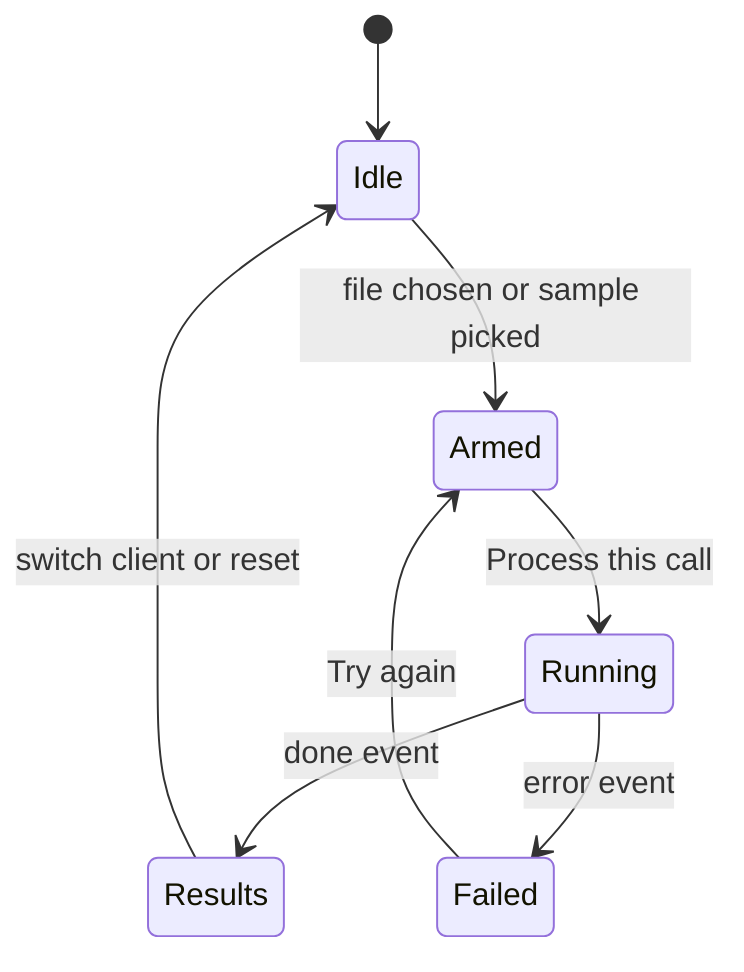

# 03. Frontend

The frontend is **already built** as one self-contained HTML file with hard-coded sample data. This doc describes it and lists exactly what to change to connect it to a real backend.

Prototype file: `quill-v4.html` (also published as an artifact). Copy it to `apps/web/public/index.html` and serve it from the API with `express.static`. Keep it plain HTML, CSS and JS for the two-day scope. No framework port needed.

## Pages

Hash-routed (`#home`, `#start`, `#app`, `#dashboard`).

| Page | Purpose |
|---|---|
| Overview (`#home`) | Landing: what Quill does, how it fits a week, roles, what leaves the laptop |
| Onboarding (`#start`) | 3 steps: work type, how you record calls, meet your sample client |
| Workspace (`#app`) | Left: clients. Centre: add a call and the step trace. Right: ledger on top, results below |
| Dashboard (`#dashboard`) | Counts, "Needs you", "Coming up", "Clients at a glance" |

## Workspace layout

```
| Clients | Add a call + step trace          | Left your laptop (ledger) |
| Dana    | [drop zone] [Process] [Sample]   | What Quill found:         |
| Marcus  | Show technical details [ ]       |  summary, promises,       |
| Ines    | Step 1 ... Step 7                |  question, drafts         |
```

## Hard-coded data to replace

| Variable in file | What it holds | Real source |
|---|---|---|
| `C` | Three sample cases (client, promises, trace text, drafts) | `GET /api/clients`, `GET /api/calls/:id/results` |
| `ST` | Step titles and technical labels | Step events from SSE |
| `P` | Promises across clients (dashboard) | `GET /api/dashboard` |
| `R` | Reminders | `GET /api/reminders` |
| `L` | Egress ledger history | `GET /api/egress` |
| `LAST` | Last call per client | `GET /api/dashboard` |

## Wiring map

| UI element | Today | Real behaviour |
|---|---|---|
| Client sidebar | Built from `C` | `GET /api/clients` |
| Drop zone and file input | Only shows the filename | `POST /api/calls` with `FormData` (file, clientId) |
| "Use the sample call" | Arms the sample | `POST /api/calls/sample` with `{clientKey}` |
| Step trace | Timed `setTimeout` loop | Subscribe to SSE, append a row per `step` event |
| Egress ledger entries | Pushed from step data | Entries arrive on step events that carry `egress` |
| Results panel | `results(c)` template | `GET /api/calls/:id/results`, same template |
| Unclear-promise question | Local state | `POST /api/commitments/:id/answer` |
| Approve and queue | Local state | `POST /api/actions/:id/approve` |
| Schedule reminder | Pushes to `R` | `POST /api/actions/:id/approve` (creates a Temporal timer) |
| Dashboard | Derived from `P`, `R`, `C` | `GET /api/dashboard` |

## Code to add

Upload and subscribe:

```js
async function startCall(clientId, file) {
  const fd = new FormData();
  fd.append('clientId', clientId);
  fd.append('audio', file);
  const { callId } = await (await fetch('/api/calls', { method: 'POST', body: fd })).json();
  const es = new EventSource(`/api/calls/${callId}/stream`);
  es.addEventListener('step', e => addStep(JSON.parse(e.data)));
  es.addEventListener('done', async () => {
    es.close();
    renderResults(await (await fetch(`/api/calls/${callId}/results`)).json());
  });
  es.addEventListener('error', () => showError('Processing stopped. Try again.'));
}
```

`addStep` is the body of the existing `nx()` row builder. `renderResults` is the existing `results(c)` function, taking API data instead of `C[key]`.

## Changes to make, in order

1. Serve the file from the API and replace `C` with fetched clients.
2. Make file upload real. Add a **client picker** if more than one client exists.
3. Replace the timed step loop with the SSE subscription.
4. Render results from the results endpoint. Wire approve, dismiss and answer buttons.
5. Replace dashboard data with `GET /api/dashboard`.
6. Add loading, empty and error states (below).
7. In the egress ledger wording, say that the prediction call also includes the anonymized training table (see 09).
8. Approved email: show **Copy email** and **Open in mail app** (`mailto:`). Do not claim it was sent.

## States to add

| State | Behaviour |
|---|---|
| Transcription fails | Step row turns red, message says what failed, "Try again" button |
| Model times out | Same, with a note to use a smaller model |
| Unsupported file | Inline message before upload ("Use an audio or video file") |
| Empty client | "No calls yet. Add the first one." |
| Replay mode | Small banner: "Demo mode. This replays a recorded run." |

## Design tokens

| Token | Value |
|---|---|
| Ink | `#111418` |
| Muted | `#5B6470` |
| Line | `#E3E6EA` |
| Accent (blue ink) | `#23408E`, tint `#E8EDF8` |
| Local / OK green | `#1A7F5A`, tint `#E5F3EC` |
| Left-laptop amber | `#9A5B00`, tint `#FBF0DC` |
| Display font | Instrument Serif |
| Body font | Geist |

Rules: plain language by default ("Listening to the call", not `transcribe_audio`); technical names only behind the "Show technical details" toggle; amber always means "left the laptop", green always means "stayed local".

## Accessibility and responsive

Visible keyboard focus, `prefers-reduced-motion` respected, columns stack under 980px, tab links wrap on mobile, tables scroll horizontally inside their own container.

## Known gaps

Multi-file queue, add-client form, editing the "who said it" label on a promise, real error handling. The prototype also always plays the sample, whatever file you pick.

## Workspace state



Switching client always returns to Idle and cancels any running subscription.
