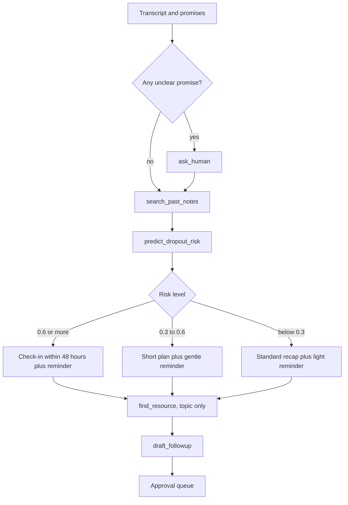

# 05. The agent

## What is agentic and what is not

An agent chooses its next step based on what it finds. Quill splits the work so a small local model stays reliable:

| Part | Type | Why |
|---|---|---|
| Transcribe | Fixed activity | Always needed, no decision |
| Extract promises | Fixed activity with a strict JSON schema | Needs consistency |
| **History, risk, decide, resource, draft, reminder** | **Agent** | The model picks tools and the next step from context |

In the UI these are seven steps. The honest description in the post: *perception is fixed, decisions are the agent's*.

## Inputs to the agent

```ts
interface AgentInput {
  client: { id: string; name: string; role: Role; gig: string };
  practitionerName: string;
  transcript: string;              // plain text, no speaker labels
  commitments: Commitment[];       // from extraction, including unclear ones
  today: string;                   // ISO date
}
```

## Tools

All tools use zod schemas. Each is wrapped in a Sentry span and emits a `step` event.

| Tool | Input | Output | Egress |
|---|---|---|---|
| `search_past_notes` | `{ clientId, query }` | up to 5 chunks with call date and text | None (local vector search) |
| `predict_dropout_risk` | `{ clientId }` (features are computed server-side) | `{ risk: number, features }` | Yes, via gate (see 09) |
| `find_resource` | `{ topic }` (4 to 8 words, no names) | `{ title, url, snippet }` | Yes, via gate |
| `draft_followup` | `{ kind, tone, points[], attachment? }` | `Draft` | None |
| `schedule_reminder` | `{ text, when }` | `Draft` of kind reminder | None until approved |
| `ask_human` | `{ commitmentId, question }` | marks as needing an answer | None |

```ts
export const predictDropoutRisk = createTool({
  id: 'predict_dropout_risk',
  description: 'Estimate how likely this client is to stop working with you, using attendance numbers only.',
  inputSchema: z.object({ clientId: z.string() }),
  outputSchema: z.object({ risk: z.number().min(0).max(1), summary: z.string() }),
  execute: async ({ context }) => { /* build features, call egress wrapper, return */ },
});
```

(Sketch. **Verify** the current `createTool` signature in the Mastra docs.)

## Decision policy

The agent's instructions include this table, and tests check it.

| Situation | Next step |
|---|---|
| Risk 0.6 or higher | Friendly check-in within 48 hours, reminder for you |
| Risk 0.3 to 0.6 | Short plan the client can do alone, gentle reminder |
| Risk below 0.3 | Standard recap, light reminder only |
| Any unclear commitment | `ask_human`, never guess |
| Client mentions a possible new scope | Add to your list, do not draft a pitch |
| Past notes show a repeated delay | Mention it in the draft, politely |

The agent must output a one-sentence `why`. It appears in the UI as "Why: ...".

## System prompt (draft)

```
You are Quill, an assistant for {{practitionerName}}, who runs paid one-on-one calls with clients.
After each call you decide the best follow-up. You never send anything: you only draft, and the
practitioner approves.

Rules:
- Use only facts from the transcript, the commitments list, and tool results. Do not invent promises,
  dates, or details.
- If a commitment is unclear, call ask_human. Do not treat it as firm.
- Check earlier calls with search_past_notes before judging whether a client is drifting.
- Call predict_dropout_risk once. Apply the decision policy exactly.
- find_resource topics must be general (for example "evening wind-down worksheet"). Never include
  names, companies, or anything from the transcript that identifies a person.
- Write drafts in a warm, plain tone, under 120 words, signed with the practitioner's name.
- Finish with a one-sentence reason for your chosen next step.
```

## Extraction prompt (fixed activity)

Ask for JSON only, validated with zod, retried up to 2 times on invalid output.

```
From this call transcript between {{practitionerName}} (the practitioner) and {{clientName}} (the client),
list every commitment made. For each: who (you or client), text, due (as spoken, or null),
firm (true if stated definitely, false if hedged with words like maybe, might, probably, I'll try),
quote (the exact sentence from the transcript).
Return JSON: { "commitments": [ ... ] }. Do not include anything not said.
```

Mapping: `firm=false` becomes status `unclear` and creates the question card.

## Speaker problem

The transcript has no speaker labels. The model infers who said what from context and the two names. This is the weakest point. Mitigations: show the `quote` beside each promise, let the user flip `who` (PATCH), and measure attribution accuracy in testing (12). See 06.

## Output the agent must produce

```ts
interface AgentOutput {
  why: string;
  drafts: { kind: 'email' | 'reminder'; subject?: string; body: string; remindAt?: string }[];
  questions: { commitmentId: string; text: string }[];
}
```

Validate with zod. On failure retry once, then fall back to a plain recap draft and set `why` to "Quill could not decide, so it drafted a standard recap."

## Guardrails

- Hard cap of 8 tool calls per run, 90 seconds total.
- The egress wrapper blocks any tool call whose payload fails the redaction gate (see 09).
- Drafts always begin as `pending`.
- Quotes in the promise table must be substrings of the transcript (checked in code).

## Failure handling

| Failure | Result |
|---|---|
| LLM returns invalid JSON | Retry twice, then error step with a clear message |
| TabPFN unavailable | Skip risk, note "Risk not estimated", continue |
| SerpApi unavailable or capped | Skip the attachment, continue |
| Agent loops | Stopped by the tool-call cap |

## Model choice

Test candidates early (see 06). Selection criteria: valid JSON rate, correct tool choice, latency under 60 seconds per call, and the policy table followed in at least 11 of 12 eval sessions.

## Observability

Each tool call: span name `tool.<id>`, attributes for duration and sizes. Whole run: span `agent.run`. Record model name, tokens in and out if available. See 10.

## Decision flow



The branch at "Risk level" is plain code (`decide()` in 16), so it can be unit-tested. The model writes the content and the `why`.
