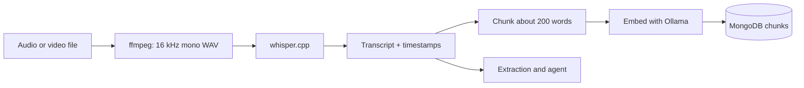

# 06. Speech and models

## Pipeline



## Transcription

| Item | Choice |
|---|---|
| Convert | `ffmpeg -i input -ar 16000 -ac 1 -c:a pcm_s16le out.wav` |
| Engine | whisper.cpp (open weights, runs on CPU) |
| Model | `small.en` for speed, `medium.en` for accuracy (compare, see 12) |
| Output | Text plus segment timestamps (use the JSON output flag, **verify** flag names) |

```bash
git clone https://github.com/ggml-org/whisper.cpp
cd whisper.cpp
cmake -B build && cmake --build build -j --config Release
sh ./models/download-ggml-model.sh small.en
./build/bin/whisper-cli -m models/ggml-small.en.bin -f out.wav -oj -of out
```

Binary name and repo location have changed in the past. **Verify** against the current README.

Call it from Node with `child_process.execFile`, with a timeout of 10 minutes and a progress log.

Other languages: use the multilingual models (`small`, not `small.en`). Not in MVP scope.

## Speaker attribution

Whisper does not say who is speaking. Options:

| Option | Effort | Quality |
|---|---|---|
| LLM infers from context and the two names | None extra | Imperfect, our MVP choice |
| Separate audio tracks per participant | Depends on the recording tool (**verify** whether Zoom offers it) | Best |
| Diarization model | High | Good, heavy for two days |

MVP: LLM inference, the exact `quote` shown beside every promise, and a button to flip "you / client". Measure accuracy on the synthetic set. Describe the limitation in the post.

## Language model

Served through Ollama on `localhost:11434`. Candidates to compare in the first hours:

| Candidate | Why | Pull command |
|---|---|---|
| Qwen3 8B | Strong at structured output at its size | `ollama pull qwen3:8b` |
| Gemma (current small variant) | Counts for the Gemma category, optional | Check the tag on ollama.com/library |
| Mistral Small | Larger, better reasoning, needs more memory | Check the tag |

Choose using the criteria in 05: valid JSON rate, tool-call correctness, latency, policy compliance. Make the model a single env var: `LLM_MODEL`.

Hardware guide (rough): an 8B model in 4-bit needs roughly 5 to 6 GB of memory. Smaller models run on laptops without a GPU, slowly. Measure and record real numbers for the post.

## Embeddings

`ollama pull nomic-embed-text` (768 dimensions, **verify**). Chunk transcripts into about 200 words with 30 words of overlap, store `start` time, and embed each chunk. Use the same model for queries.

## Context limits

A 40-minute call is roughly 6,000 words. Many local models handle that, but keep a safety margin: if the transcript exceeds the model's limit, summarize by chunks first (map step), then run extraction on the merged result. Log when this happens.

## Swapping models

`LLM_MODEL`, `EMBED_MODEL` and `WHISPER_MODEL` are env vars. The benchmark in 12 runs the same eval set across models without code changes. This is the "open lets you swap" evidence for the post.

## Replay mode

Replay does not load any model. It serves `data/replay/<client>.json`, recorded from a real live run, including step timings and egress entries.

## Fallback

If local models are too slow or weak: use a hosted open-weight endpoint with a free tier through the same OpenAI-compatible interface, set by `LLM_BASE_URL`. Say so in the post. Local-only claims then apply only to the speech step. **Verify** which providers offer free tiers.
