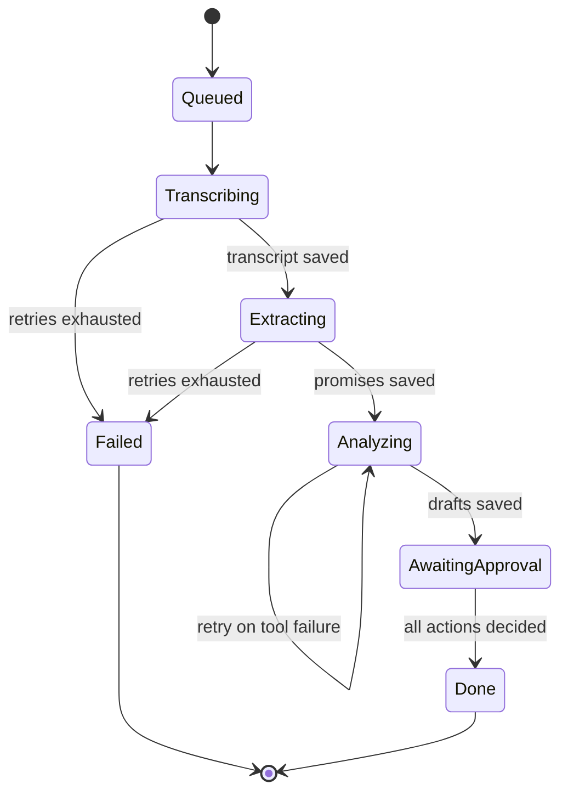

# 08. Workflows (Temporal)

## Why Temporal

Processing a call takes minutes and calls several tools. If the laptop sleeps or a tool fails, we want to resume, not restart. Reminders need to fire days later even after a restart. Temporal gives retries, durable timers and a history of what happened.

Run locally with the dev server: `temporal server start-dev` (**verify** CLI install). Render's free tier will not host it, so replay mode does not use Temporal.

## Workflows

### `processCall(callId)`



### `reminder(actionId, remindAt)`

Started when a reminder draft is approved. Sleeps until `remindAt`, then marks the reminder `due`. Can be cancelled by a signal (for example, the client replied or the user marked it done).

## Activities

| Activity | What it does | Retry policy |
|---|---|---|
| `transcribe(callId)` | ffmpeg then whisper, saves transcript | 2 attempts, 10 min timeout |
| `embedChunks(callId)` | Chunks and embeds transcript | 3 attempts |
| `extractCommitments(callId)` | LLM with JSON schema, zod validation | 3 attempts |
| `runAgent(callId)` | Mastra agent, saves steps, drafts, egress | 2 attempts, 120 s timeout |
| `markReminderDue(reminderId)` | Sets state `due` | 5 attempts |

Each activity writes its step to the `steps` collection so the SSE stream can emit it. The API watches the collection (or an in-memory emitter) and forwards events.

## Signals

| Signal | Sent when | Effect |
|---|---|---|
| `actionDecided(actionId, state)` | User approves or dismisses | Workflow tracks pending actions, finishes when none left |
| `cancelReminder` | User marks done or snoozes | Reminder workflow stops or restarts with a new time |

## Sketch

```ts
// workflows/processCall.ts (verify the SDK imports against current docs)
import { proxyActivities, defineSignal, setHandler, condition } from '@temporalio/workflow';
import type * as acts from '../activities';

const a = proxyActivities<typeof acts>({
  startToCloseTimeout: '10 minutes',
  retry: { maximumAttempts: 3 },
});
export const actionDecided = defineSignal<[string, 'approved' | 'dismissed']>('actionDecided');

export async function processCall(callId: string) {
  await a.transcribe(callId);
  await a.embedChunks(callId);
  await a.extractCommitments(callId);
  const pending = new Set(await a.runAgent(callId)); // returns action ids
  setHandler(actionDecided, (id) => { pending.delete(id); });
  await condition(() => pending.size === 0, '30 days');
}
```

## Idempotency

Every activity checks whether its output already exists for the `callId` before doing work. Actions carry an idempotency key `(callId, kind, index)`. Approving the same action twice never starts two reminder timers (workflow ID `reminder-<actionId>`).

## Local commands

```bash
temporal server start-dev            # server and UI at localhost:8233
npm run worker                       # starts apps/api/src/worker.ts
```

## Failure demos (also tests, see 12)

1. Kill the worker mid-analysis, restart it, and the workflow continues from the last completed activity.
2. Make the search tool return a 500 for the first two attempts; it succeeds on the third; one ledger entry per real attempt.
3. Approve a reminder, restart everything, confirm the timer still fires.
