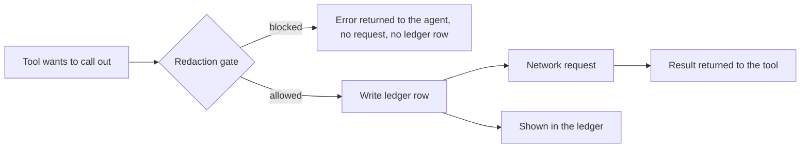

# 09. Privacy and egress

This is Quill's differentiator: not "private because we say so", but "here is everything that left, with its exact contents".

## What stays and what leaves

| Data | Where it lives | Leaves the laptop? |
|---|---|---|
| Audio files | Local disk | Never |
| Transcripts and chunks | Local MongoDB | Never |
| Embeddings | Local MongoDB | Never |
| Promises, drafts, reminders | Local MongoDB | Never |
| Attendance numbers (no names) | Computed locally | Sent to a prediction service, or run locally (setting) |
| A general search topic | Built by the agent, checked by the gate | Sent to the search provider (setting to turn off) |
| Traces | Sentry | Metadata only, see below |

The public **replay** deployment on Render uses only synthetic data. No real client information ever touches the cloud.

## Egress wrapper

Every outbound HTTP request goes through one function. No other code calls `fetch`, `axios` or similar for external hosts.

```ts
// egress/wrapper.ts
export async function egressFetch(opts: {
  to: string;              // display name, e.g. "TabPFN prediction service"
  url: string;
  body: unknown;           // exact payload
  reason: string;          // why this call is needed
  callId?: string;
}) {
  gate(opts);                                  // throws if the payload is not allowed
  await db.egress.insertOne({ to: opts.to, contents: describe(opts.body), reason: opts.reason, callId: opts.callId, at: new Date() });
  return fetch(opts.url, { method: 'POST', headers: {...}, body: JSON.stringify(opts.body) });
}
```

The ledger entry is written **before** the request, so a failed request is still visible.

A test and a lint check fail the build if `fetch(` appears outside the wrapper and the local-only helpers (Ollama on localhost, Temporal on localhost, MongoDB).

## Redaction gate

Allowlisted payload shapes:

| Destination | Allowed |
|---|---|
| Prediction | Numeric features only: `calls_so_far`, `avg_gap_days`, `last_gap_days`, `missed_count`, `avg_reply_hours`, `days_since_last_call` |
| Search | A string of 4 to 8 words |

Search gate rules: reject if the string contains any client name, practitioner name, or capitalized word that appears in the client record or the transcript; reject if it contains digits that look like emails, phones or dates; reject if longer than 8 words. If rejected, the agent gets an error and must rephrase or skip.

## The training table caveat

TabPFN works by taking labeled example rows plus the new row to predict. With the hosted API, the request therefore includes **the training table as well as this client's numbers**. In the demo that table is synthetic. In real use it would be anonymized history. The ledger entry must say so, for example:

> Sent to TabPFN prediction service: 6 numbers about this client, plus 600 anonymized example rows. No name, audio or transcript.

Update the frontend wording accordingly (see 03). Setting "Run the dropout prediction on this laptop" avoids the call entirely by using the local package (**verify** local license terms and hardware needs).

## Sentry

Send only metadata: span names, durations, token counts, model names. Never send transcript text, prompts, or tool arguments that contain client content. Configure `beforeSend` to drop request bodies and set `sendDefaultPii: false`. Any AI-instrumentation option that records inputs and outputs must be **off** for real use (it can be on for the synthetic demo, and say so).

## What we can claim

- "Your recordings and transcripts never leave your laptop." (testable, see 12)
- "Everything that does leave is listed with its exact contents."
- "Turn off prediction and search and nothing leaves at all."

## What we do not claim

Compliance with any regulation, that the synthetic demo proves accuracy on real data, or that third parties we call (prediction, search) have particular policies.

## Ledger UI

Amber entries in the right column, newest first. The Dashboard and a future Privacy view read `GET /api/egress`. Counters shown: recordings sent (always 0), transcripts sent (always 0), small requests (count).

## Egress flow


