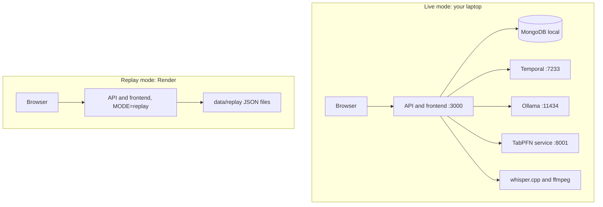

# 11. Deployment and setup

## Prerequisites

| Tool | Notes |
|---|---|
| Node 20 or newer | API, worker, frontend serving |
| Python 3.11 or newer | TabPFN service, data generators |
| ffmpeg | Audio conversion |
| Ollama | Local LLM and embeddings |
| whisper.cpp build | Transcription (see 06) |
| Docker | Local MongoDB (or install MongoDB directly) |
| Temporal CLI | Local dev server |
| Git and a GitHub account | Repo and Copilot |

## Install

```bash
# models
ollama pull qwen3:8b
ollama pull nomic-embed-text

# database (verify image name and vector search support)
docker run -d --name quill-mongo -p 27017:27017 mongodb/mongodb-atlas-local

# temporal
temporal server start-dev

# node
npm install
cp .env.example .env

# python
cd services/tabpfn && python -m venv .venv && . .venv/bin/activate && pip install -r requirements.txt
```

## Environment variables (`.env.example`)

```
MODE=live                         # live or replay
PORT=3000
MONGODB_URI=mongodb://localhost:27017/quill
LLM_BASE_URL=http://localhost:11434
LLM_MODEL=qwen3:8b
EMBED_MODEL=nomic-embed-text
WHISPER_BIN=./whisper.cpp/build/bin/whisper-cli
WHISPER_MODEL=./whisper.cpp/models/ggml-small.en.bin
TEMPORAL_ADDRESS=localhost:7233
TABPFN_URL=http://localhost:8001
TABPFN_TOKEN=
SERPAPI_KEY=
ELEVENLABS_API_KEY=
SENTRY_DSN=
PRACTITIONER_NAME=Alex
```

## Run (live mode, five processes)

```bash
ollama serve                        # if not already running
temporal server start-dev
uvicorn app:app --port 8001         # in services/tabpfn
npm run worker
npm run dev                         # API plus frontend at http://localhost:3000
```

## Smoke test

1. `npm run seed` loads clients and history.
2. Open the app, pick Dana, press **Use the sample call**.
3. Seven steps appear. Two ledger entries appear. Results show promises, one question, an email and a reminder.
4. Approve the reminder. Open the Dashboard: it appears under "Coming up".
5. Open `localhost:8233`: the workflow history is there.
6. Sentry shows one `agent.run` trace.

## Render (replay deployment)

| Setting | Value |
|---|---|
| Service type | Web service (Node) |
| Build command | `npm install && npm run build` |
| Start command | `npm run start` |
| Env | `MODE=replay`, `MONGODB_URI` (Atlas free cluster, optional), `SENTRY_DSN` |
| Data | `data/replay/*.json` committed to the repo |

Free web services sleep when idle and take time to wake (**verify**), so open the link once before recording or sharing. The replay build contains no model, no Temporal and no secrets other than optional Sentry and Mongo.

The frontend shows a banner in replay mode: "Demo mode. This replays a recorded run."

## Atlas (cloud demo database, optional)

Create a free cluster (**verify** card requirement), allow your IP, load synthetic seed data only. Replay mode can run without a database by reading JSON, which is the safer default.

## Repo hygiene

`.env` in `.gitignore`. Audio and recordings in `.gitignore` except the synthetic samples you want to publish. License: choose an open-source license for the repo, since the challenge is about open-source AI.

## Troubleshooting

| Symptom | Likely cause |
|---|---|
| Transcription hangs | Wrong WAV format, convert to 16 kHz mono |
| Agent returns invalid JSON | Model too small, try another or lower temperature |
| No ledger entries | Tool bypassing the wrapper, check the lint test |
| Reminder never fires | Worker not running |
| Render shows blank | Cold start, wait and refresh |

## Deployment diagram


