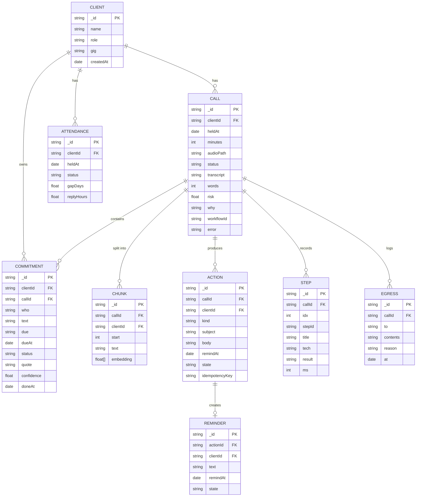
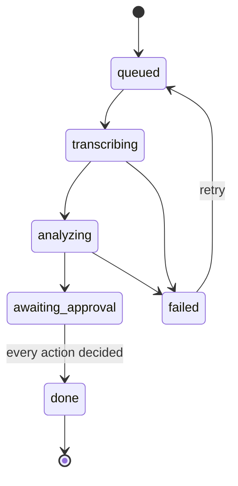
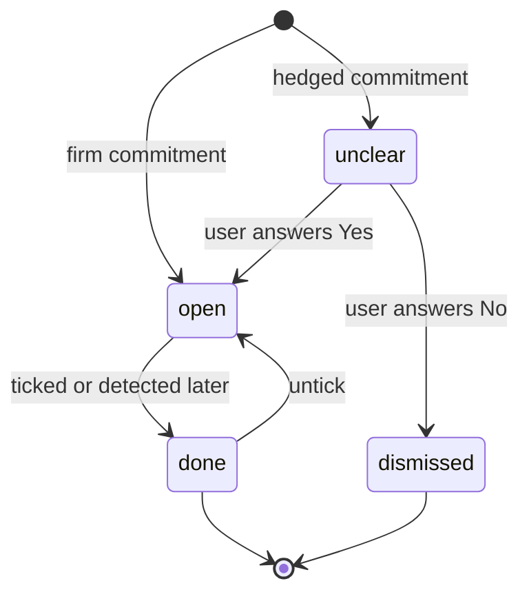
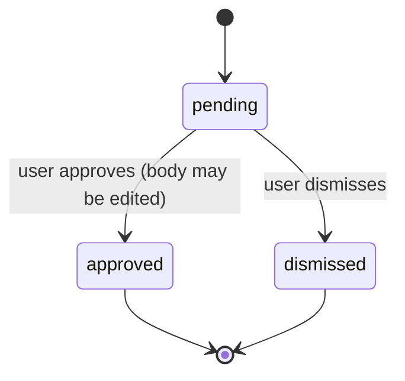
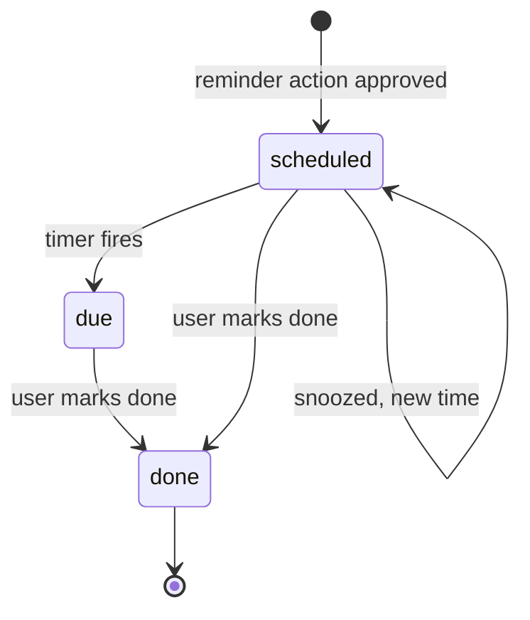

# 15. Data model

Full detail behind the summary in 07. Types here are the source of truth. The API types in 04 are views of these.

## Entity diagram



## Schemas (zod)

Put these in `apps/api/src/schemas.ts` and import everywhere. The agent output, API bodies and database writes are all validated against them.

```ts
import { z } from 'zod';

export const Role = z.enum(['freelancer', 'consultant', 'coach']);
export const Who = z.enum(['you', 'client']);

export const ClientSchema = z.object({
  _id: z.string(),
  name: z.string().min(1).max(80),
  role: Role,
  gig: z.string().max(120),
  createdAt: z.date(),
});

export const CallStatus = z.enum(['queued', 'transcribing', 'analyzing', 'awaiting_approval', 'done', 'failed']);

export const CallSchema = z.object({
  _id: z.string(),
  clientId: z.string(),
  heldAt: z.date(),
  minutes: z.number().int().positive(),
  audioPath: z.string(),
  status: CallStatus,
  transcript: z.string().optional(),
  words: z.number().int().nonnegative().optional(),
  risk: z.number().min(0).max(1).nullable().optional(),
  why: z.string().max(400).optional(),
  workflowId: z.string().optional(),
  error: z.string().optional(),
});

export const CommitmentStatus = z.enum(['open', 'done', 'unclear']); // 'overdue' is computed, never stored

export const CommitmentSchema = z.object({
  _id: z.string(),
  clientId: z.string(),
  callId: z.string(),
  who: Who,
  text: z.string().min(3).max(200),
  due: z.string().nullable(),            // as spoken: "Friday", "next week"
  dueAt: z.date().optional(),            // resolved, see rules below
  status: CommitmentStatus,
  quote: z.string().min(5),              // must be a substring of the transcript
  confidence: z.number().min(0).max(1),
  doneAt: z.date().optional(),
});

export const ExtractionOutput = z.object({
  commitments: z.array(z.object({
    who: Who, text: z.string(), due: z.string().nullable(),
    firm: z.boolean(), quote: z.string(),
  })),
});

export const ChunkSchema = z.object({
  _id: z.string(), callId: z.string(), clientId: z.string(),
  start: z.number().int().nonnegative(),          // seconds into the call
  text: z.string(),
  embedding: z.array(z.number()).length(768),     // match EMBED_MODEL dimension
});

export const ActionSchema = z.object({
  _id: z.string(), callId: z.string(), clientId: z.string(),
  kind: z.enum(['email', 'reminder']),
  subject: z.string().optional(),
  body: z.string().min(1),
  remindAt: z.date().optional(),
  state: z.enum(['pending', 'approved', 'dismissed']),
  idempotencyKey: z.string(),                     // `${callId}:${kind}:${index}`
});

export const ReminderSchema = z.object({
  _id: z.string(), actionId: z.string().optional(), clientId: z.string(),
  text: z.string(), remindAt: z.date(),
  state: z.enum(['scheduled', 'due', 'done']),
});

export const StepSchema = z.object({
  _id: z.string(), callId: z.string(), idx: z.number().int(),
  stepId: z.enum(['transcribe', 'extract', 'history', 'risk', 'decide', 'resource', 'draft']),
  title: z.string(), tech: z.string(), result: z.string(), ms: z.number().int(),
  egress: z.object({ to: z.string(), contents: z.string() }).optional(),
});

export const EgressSchema = z.object({
  _id: z.string(), callId: z.string().optional(),
  to: z.string(), contents: z.string(), reason: z.string(), at: z.date(),
});

export const RiskFeatures = z.object({
  calls_so_far: z.number().int().nonnegative(),
  avg_gap_days: z.number().nonnegative(),
  last_gap_days: z.number().nonnegative(),
  missed_count: z.number().int().nonnegative(),
  avg_reply_hours: z.number().nonnegative(),
  days_since_last_call: z.number().nonnegative(),
});

export const AgentOutput = z.object({
  why: z.string().max(400),
  drafts: z.array(z.object({
    kind: z.enum(['email', 'reminder']),
    subject: z.string().optional(),
    body: z.string(),
    remindAt: z.string().optional(),               // ISO date
  })).min(1).max(3),
  questions: z.array(z.object({ commitmentId: z.string(), text: z.string() })),
});
```

## State machines

### Call



### Commitment



`dismissed` is represented by deleting the commitment (or storing `status: 'dismissed'` if you want an audit trail; add it to the enum then). `overdue` is a **view**: `status === 'open'` and `dueAt < now`.

### Action



### Reminder



## Derived values and rules

| Value | Rule |
|---|---|
| Overdue | `status = open` and `dueAt` before now. Computed at read time. |
| `dueAt` from `due` | Weekday name: next occurrence after the call date. "tomorrow": call date + 1. "next week": Monday after the call date. "this week": Friday of the call week. "tonight": call date. Anything else: leave `dueAt` empty and show the text. |
| Client status | From the latest call's `risk`: 0.6 or more is `attention`, 0.3 to 0.6 is `watch`, below 0.3 is `ok`. No risk yet: `ok`. |
| Status label | Short text from the agent's `why`, or a default per level ("may be going quiet", "might pause", "is on track"). |
| Invoices to send | Open commitments by `you` whose text matches `/invoice/i`. |
| Attendance features | Computed from `attendance` rows for the client up to now (see `RiskFeatures`). |
| Idempotency key | `${callId}:${kind}:${index}`; unique index on `actions.idempotencyKey`. |

## Constraints

| Collection | Constraint |
|---|---|
| `actions` | Unique `idempotencyKey` |
| `commitments` | `quote` must appear in the call's transcript (checked in code before insert) |
| `chunks` | Embedding length equals the embedding model dimension |
| `calls` | `status` follows the call state machine; no transitions out of `done` |
| `reminders` | At most one scheduled reminder per `actionId` |

Optional Mongo-side validation for the most important one:

```js
db.createCollection('commitments', { validator: { $jsonSchema: {
  bsonType: 'object',
  required: ['clientId', 'callId', 'who', 'text', 'status', 'quote', 'confidence'],
  properties: {
    who: { enum: ['you', 'client'] },
    status: { enum: ['open', 'done', 'unclear'] },
    confidence: { bsonType: 'double', minimum: 0, maximum: 1 }
  }
}}});
```

## Mapping to the prototype

| Prototype field (`C[key]`) | Stored as |
|---|---|
| `name, role, gig` | `clients` |
| `p` (promises) and `u` (unclear) | `commitments` (`u` has `status: 'unclear'`) |
| `t[0..4]` (trace text) | `steps.result` |
| `eg`, `eq` | `egress.contents` |
| `fl`, `fw` (flag, warn) | Derived from `calls.risk` |
| `why` | `calls.why` |
| `mail` | `actions` with `kind: 'email'` |
| `rem` | `actions` with `kind: 'reminder'`, then `reminders` |

## Example: one processed call

```json
{
  "call": { "_id": "c-dana-06", "clientId": "dana", "heldAt": "2026-10-14T15:00:00Z", "minutes": 34,
            "status": "awaiting_approval", "risk": 0.68,
            "why": "Dana missed 2 of the last 4 calls and a decision is still open, so a friendly check-in fits better than a plain recap." },
  "commitments": [
    { "who": "client", "text": "Send brand guidelines", "due": "Friday", "status": "open", "quote": "I'll get you the brand guidelines by Friday." },
    { "who": "client", "text": "Approve the logo", "due": "next week", "status": "unclear", "quote": "Maybe I can approve the logo next week." }
  ],
  "actions": [
    { "kind": "email", "state": "pending", "idempotencyKey": "c-dana-06:email:0" },
    { "kind": "reminder", "state": "pending", "remindAt": "2026-10-22T09:00:00Z", "idempotencyKey": "c-dana-06:reminder:1" }
  ],
  "egress": [
    { "to": "TabPFN prediction service", "contents": "6 numbers about this client plus 600 anonymized example rows" }
  ]
}
```
