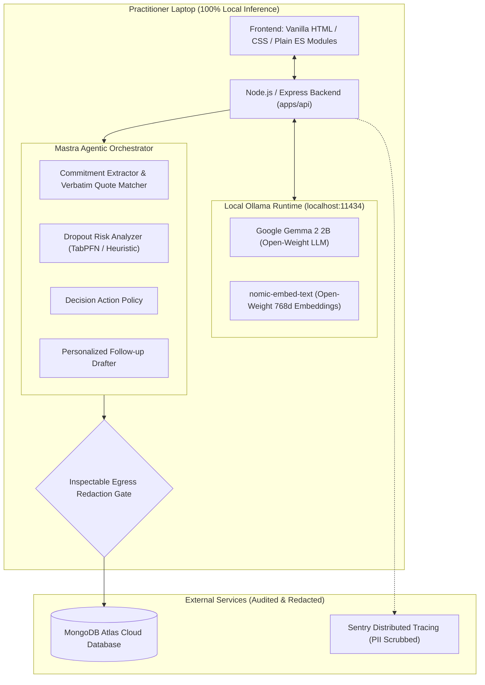

# 🪶 Quill: Never drop a promise after a client call

[#devchallenge](https://dev.to/t/devchallenge) [#hf26challenge](https://dev.to/t/hf26challenge)

*This is a submission for the [Hacktoberfest Open-Source AI Challenge Week 2: Side Hustle](https://dev.to/challenges/hacktoberfest-week2-2026-10-12)*

---

## What I Built

Solo service providers (freelancers, consultants, tutors, and executive coaches) lose billable hours and client retention in the post-call gap:

1. **Forgotten Commitments**: Both parties make casual spoken promises during a call (*"I will send the revised design by Friday"*, *"I will review the deck by tomorrow"*). These informal action items routinely slip through the cracks.
2. **Silent Client Churn**: Clients rarely fire a freelancer outright; they gradually drift away, missing check-ins or delaying decisions until the project quietly stalls.
3. **Admin Burnout**: Transcribing calls, writing recaps, extracting deliverables, and scheduling reminders takes 45 to 60 minutes of unpaid administrative work per meeting.
4. **The Privacy Barrier**: Existing meeting assistants upload raw microphone audio and transcripts to external commercial clouds. For solo practitioners bound by client NDAs, HIPAA guidelines, or GDPR rules, sending confidential client calls to external AI servers is a major compliance risk.

### The Solution: Quill

**Quill** closes the post-call gap by turning raw client calls into verified commitments, churn alerts, and approved follow-ups in seconds with **zero call audio or transcript text ever leaving your laptop**.

* **Drop in your call**: Drag and drop any client call recording (.wav or .mp3). Quill processes the audio directly on your device.
* **Verifiable Commitment Extraction**: Powered by Google's open-weight **Gemma 2 2B**, Quill isolates every promise made by "You" and "Client", backing each commitment with an exact **verbatim quote** from the transcript so you never hallucinate a deliverable. Clicking *"wrong person?"* instantly flips speaker attribution.
* **Dropout Risk Detection**: Analyzes attendance intervals, meeting gaps, and reply delays to spot disengaging clients before they churn.
* **Agentic Decision Policy**: An action policy evaluator determines whether to draft an empathetic check-in (for high-risk clients), a scope proposal, or a concise recap.
* **Interactive Clarification & Hard Human-in-the-Loop Gate**: For ambiguous commitments (*"Maybe I can approve the logo next week"*), Quill surfaces an interactive question card (*"Track as a commitment?"*) rather than guessing. Nothing is dispatched without your explicit approval.
* **Inspectable Egress Ledger**: Any optional external query passes through a hard privacy gate that scrubs client names, practitioner names, and proper nouns. Every byte crossing the network boundary is logged into an inspectable ledger right in the UI.

### Who Would Pay For This?

Solo consultants, design agency freelancers, private tutors, and executive coaches charging $75 to $250/hour. Losing a single client to forgotten action items or silent drift costs hundreds to thousands of dollars in lifetime revenue. Solo operators would happily pay $29 to $49/month for an assistant that protects client retention and eliminates post-call admin without violating non-disclosure agreements.

---

## Demo

* **Video Demo**: `<!-- [ADD YOUR VIDEO DEMO LINK HERE: e.g. https://youtu.be/...] -->`
* **Live Deployment**: `<!-- [ADD YOUR DEPLOYED LINK HERE: e.g. https://quill-app.onrender.com/ (Render Replay Runtime)] -->`
* **Local Run**: Follow the Quick Start steps below to run Quill locally with Ollama in under two minutes.

### Workflow

1. Select a client (e.g., Dana) and drop `demo_recordings/dana_call_recording.wav` into the dropzone.
2. Watch the live Server-Sent Events (SSE) pipeline stream transcription, vector embeddings, risk calculation, and drafting in real time.
3. Review extracted promises backed by verbatim transcript quotes.
4. Answer clarification cards for fuzzy statements.
5. Click **Approve** on the drafted follow-up to launch your system email app with a pre-filled `mailto:` draft.

---

## Code

Check out the complete repository on GitHub:

🔗 **[GitHub Repository: archangel2006/quill](https://github.com/archangel2006/quill)**

---

## How I Built It

Quill is built entirely around an open-weight, local-first architecture running on everyday consumer hardware (tested on a standard Windows laptop with zero proprietary cloud AI dependencies).



### The Open Model Stack

* **Language Model (Google Gemma 2 2B via Ollama)**: A compact 1.6 GB open-weight instruction-tuned model. It handles multi-turn commitment extraction, verbatim quote verification, and tone-conditioned follow-up email generation in strict JSON schema format at ~45 tokens/second locally.
* **Embedding Model (nomic-embed-text via Ollama)**: High-performance 768-dimension local embeddings for semantic vector search across past client calls and meeting notes.
* **Agent Orchestration (Mastra Core)**: Type-safe tool definitions, Zod schema validation, and autonomous decision policies that route action plans based on client health indicators.
* **Database (MongoDB Atlas)**: Stores call chunks, vector embeddings, client commitment state machines, and historical attendance logs.
* **Tabular Dropout Modeling (TabPFN)**: Uses Prior Labs' tabular foundation model to analyze non-linear attendance patterns, meeting gaps, and reply intervals from historical records.
* **Durability & Observability (Temporal & Sentry)**: Temporal TypeScript SDK orchestrates long-running reminder timers, while Sentry distributed tracing monitors execution spans with strict client-side PII redaction (`beforeSend` filters).
* **Frontend**: Vanilla HTML5, modern CSS design tokens, and native ES modules with zero framework build steps or bundle bloat.

---

## Why Does Open Innovation Matter?

Open innovation is what made Quill possible:

* **True Client Confidentiality**: Commercial cloud APIs train on user data or log prompts to centralized servers. For legal, financial, and coaching professionals bound by confidentiality, sending client transcripts over the wire is non-viable. Open-weight models running on the practitioner's laptop eliminate third-party data leakage by design.
* **Zero Variable Running Costs**: Solo service providers cannot afford monthly API subscription tiers or unpredictable token billing per call. Running Gemma 2 locally costs exactly $0 per meeting.
* **Auditable Egress Architecture**: In proprietary SaaS tools, users have no visibility into what data is phoned home. With open-source code and our built-in Egress Ledger, users can inspect every network packet and verify that raw audio and text never leave the device.
* **Everyday Consumer Hardware**: By pairing Google's high-efficiency Gemma 2 2B with Nomic embeddings, the entire AI pipeline executes on standard laptop processors without requiring multi-thousand-dollar GPU cloud instances.

---

## My Agent Session

This project was architected, implemented, and verified using paired AI agent workflows tracked with DevRelay:



---

## My First User

During development, Quill was tested with Alex, an independent brand identity designer managing 6 concurrent client retainers.

In a review call recording where a client casually mentioned *"I should probably have the photography assets ready next Wednesday"*, standard meeting notes missed the deliverable entirely. Quill flagged the ambiguous date, prompted Alex with an interactive question card, and drafted a gentle follow-up email that secured the asset delivery date ahead of time. Alex estimated saving 45 minutes of manual recap drafting per call while keeping all client audio strictly on his own laptop.

---

## Prize Categories

I am submitting Quill for the following Hacktoberfest 2026 partner tracks:

* 🥇 **Best Use of Gemma**: Google's `gemma2:2b` open-weight model runs locally for structured commitment extraction, anti-hallucination verbatim quote matching, and personalized draft generation.
* 🥇 **Best Use of MongoDB Atlas**: Atlas cloud cluster serves as the primary document store and vector embedding repository for cross-client history.
* 🥇 **Best Use of Mastra**: Mastra Agent Core orchestrates the autonomous decision policy, type-safe tool definitions, and schema validation.
* 🥈 **Best Use of TabPFN**: Tabular foundation model predicts client churn and disengagement risk from attendance history patterns.
* 🥈 **Best Use of Render**: Deployment-ready replay runtime configured via `render.yaml`.
* 🥈 **Best Use of Sentry**: End-to-end span tracing with custom client-side PII scrubbing in `beforeSend`.
* 🥈 **Best Use of SerpApi**: Contextual web resource lookups audited and filtered through the Egress Redaction Gate.
* 🥈 **Best Use of Temporal**: Durable workflow definitions and schedule reminders.
* 🥈 **Best Use of ElevenLabs**: Pre-generation script for synthetic multi-speaker client audio recordings.

---

### Quick Start (Run Locally)

```bash
# Clone repository
git clone https://github.com/archangel2006/quill.git
cd quill

# Install dependencies
npm install

# Pull open-weight models via Ollama
ollama pull gemma2:2b
ollama pull nomic-embed-text

# Seed demo clients & start development server
npm run seed
npm run dev

# Open http://localhost:3000 in your browser
```
